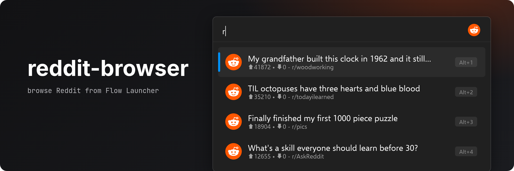

<!-- generated by readwright from docs/README.md.j2; edit the template, not this file -->


# Reddit Browser

Browse Reddit's front page and your favorite subreddits from Flow Launcher.

[](https://github.com/Garulf/Reddit-Browser/actions/workflows/tests.yml) [](https://github.com/Garulf/Reddit-Browser/releases/latest) [](https://github.com/Garulf/Reddit-Browser/releases/latest)

[](https://www.buymeacoffee.com/garulf) [](https://github.com/sponsors/Garulf)

## Features

* **Front page at a glance.** `r` lists the hot posts on Reddit's front page.
* **Any subreddit.** `r /flowlauncher` lists the hot posts in r/flowlauncher.
* **Filter as you type.** Words after the subreddit narrow the posts down by title.
* **Favorites.** Save the subreddits you visit most and reach them with `r /`.
* **Opens in your browser.** `Enter` opens the post on reddit.com.

## Usage

Type `r` and a space to see the hot posts on the front page. Keep typing to filter them by title:

```
r
r python
```


| Query | Result |
| --- | --- |
| `r` | Hot posts on the front page |
| `r <words>` | Front page posts whose title contains `<words>` |
| `r /<subreddit>` | Hot posts in that subreddit, e.g. `r /flowlauncher` |
| `r /<subreddit> <words>` | Posts in that subreddit whose title contains `<words>` |
| `r /` | Your favorite subreddits |

Flow Launcher needs a space after the action keyword, so type `r /python`, not `r/python`.

### Browse a subreddit

Type `/` followed by the subreddit name:


### Favorites

Open the context menu on a post (`Shift+Enter` or right-click) and choose **Add subreddit to favorites**.
Type `r /` to list your favorites, and select one to browse it. The same context menu has
**Remove from Favorites** for subreddits you already saved.


### When Reddit refuses the request

Reddit has started blocking requests from this plugin for some users
([#8](https://github.com/Garulf/Reddit-Browser/issues/8)). When a request fails, the plugin shows an error result instead of
posts. Press `Enter` on it to open the same page in your browser.

## Installation

### Flow Launcher

In Flow Launcher, type:

```
pm install reddit browser
```


### Manual installation

Download `Reddit-Browser-<version>.zip` from the [latest release](https://github.com/Garulf/Reddit-Browser/releases/latest) and unzip it into
`%appdata%\FlowLauncher\Plugins`, then restart Flow Launcher.

Pre-releases of the next version are published from the open release PR on the
[releases page](https://github.com/Garulf/Reddit-Browser/releases) for testing. Flow Launcher won't offer them as updates.

## Requirements

* Flow Launcher 1.17.0 or newer
* Python 3.8 or newer, which Flow Launcher can install for you

## Changelog

See [CHANGELOG.md](CHANGELOG.md) for the full history.
